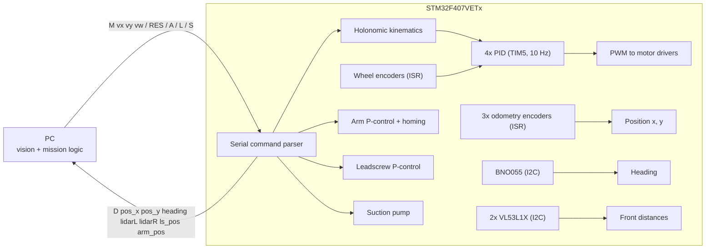

# BIMA Waste Sorting Robot: STM32 Firmware

Low-level firmware for **BIMA**, the R2C (Robotics Research Center, UKSW) waste sorting robot. It runs on an STM32F407VETx and handles holonomic drive with per-wheel PID, odometry, sensing, and the pick mechanism (arm, leadscrew, suction), all driven by text commands from a PC over USB serial.

<!-- TODO: add demo GIF/photo of the robot -->

> Full technical documentation (Indonesian): [docs/TECHNICAL_DOC_ID.md](docs/TECHNICAL_DOC_ID.md). It covers the complete pinout, every module, tuning constants and troubleshooting.
>
> PC-side companion (vision + high-level control): [altilize/Waste-sorting-robot-PC](https://github.com/altilize/Waste-sorting-robot-PC)

## Overview

The robot is split into two layers. A PC runs computer vision and the mission state machine. The STM32 is the real-time layer: it executes velocity commands, closes the motor speed loops, tracks position, and reports sensor data back on request.

## Features

- **4-wheel omni (holonomic) drive** with inverse kinematics from `(vx, vy, vw)` to per-wheel setpoints
- **Independent PID per motor** (with integral clamping anti-windup), executed from a 10 Hz hardware timer interrupt (TIM5)
- **Odometry** from 3 quadrature rotary encoders, plus **heading** from a BNO055 IMU with software zero offset
- **Dual VL53L1X ToF lidars** on a shared I2C bus, with XSHUT-based address assignment (`0x2A`, `0x2B`)
- **14-channel line sensor array** read through a 16-channel analog multiplexer, with a weighted-average line position
- **Pick mechanism**: encoder-based P-control for the arm (with limit-switch homing) and the vertical leadscrew, plus a toggled suction pump
- **Table-driven serial command parser** (`strtok` + function-pointer lookup)
- **Hardware stop button** that zeroes motion, PID state and odometry and disables the motor driver
- Onboard 6-state navigation routine (`HomeToConveyor`) using odometry, heading and lidar distance (its call is currently disabled in `loop()`; the same state machine runs on the PC side)

## System Architecture



Main loop: `calculate_position()` -> `read_compass()` -> `Lidar_Read()` -> `read_command()` -> `holonomic()` / `update_leadscrew()` / `controlArm()`. The PID runs separately in the timer ISR.

## Hardware

| Component | Qty | Role |
|-----------|-----|------|
| STM32F407VETx (Cortex-M4, 168 MHz) | 1 | Main controller |
| DC motor with encoder + omni wheel | 4 | Holonomic drive |
| Quadrature rotary encoder | 3 | Odometry |
| BNO055 IMU | 1 | Heading |
| VL53L1X ToF sensor | 2 | Left/right front distance |
| 16-channel analog MUX | 1 | 14 line sensors on one ADC pin |
| Arm motor + encoder, limit switch | 1 | Arm positioning and homing |
| Leadscrew motor + encoder | 1 | Vertical motion |
| Suction pump | 1 | Object pickup |
| Push button | 1 | Manual stop / reset |

Full pin mapping is in [docs/TECHNICAL_DOC_ID.md, section 5](docs/TECHNICAL_DOC_ID.md#5-pinout--wiring-map).

## Software Stack

- C++ on the **STM32duino** (Arduino core for STM32)
- Libraries: `Wire`, `Adafruit_BNO055`, `Adafruit_Sensor`, Pololu `VL53L1X`
- `HardwareTimer` for the 10 Hz control interrupt
- Flashed over **SWD** (ST-Link), USB CDC serial at 115200 baud

## Serial Protocol

Newline-terminated ASCII commands, case-sensitive.

| Command | Description |
|---------|-------------|
| `M <vx> <vy> <vw>` | Set holonomic velocity |
| `?` | Query state, replies `D <pos_x> <pos_y> <heading> <lidarL> <lidarR> <ls_pos> <arm_pos>` |
| `RES` | Reset motion, PID, odometry and heading offset (replies `SUDAH RESET!`) |
| `A <pos>` / `AH` | Arm target position / arm homing |
| `L <pos>` / `RLS` | Leadscrew target position / reset leadscrew encoder |
| `S` | Toggle suction (replies `1` or `0`) |
| `GO` | Set navigation state to 1 and print heading |
| `R`, `RAW_LF`, `DIG_LF` | Debug output for lidar and line sensors |

## Repository Structure

```
.
├── Waste-Sorting-Robot-Microcontroller.ino  # Pin definitions and global state
├── main.ino           # setup() and loop()
├── init.ino           # Hardware initialization (motors, encoders, lidar, timer, IMU, MUX)
├── Commands.ino       # Serial command table and handlers
├── Motion.ino         # Holonomic kinematics, motor output, arm and leadscrew control
├── PID.ino            # Per-motor PID controllers
├── Interrupt.ino      # Encoder ISRs and 10 Hz timer callback (RPM + PID)
├── Lidar_LF.ino       # Lidar, line follower and HomeToConveyor state machine
├── Gyrodometry.ino    # Odometry position and IMU heading
└── docs/
    └── TECHNICAL_DOC_ID.md  # Full technical documentation (Indonesian)
```

## Build and Flash

1. Install the Arduino IDE (or `arduino-cli`) with the **STM32duino** core and an ST-Link. A setup guide for Ubuntu is at [altilize/STM32Duino-on-Ubuntu](https://github.com/altilize/STM32Duino-on-Ubuntu).
2. Install the libraries: Adafruit BNO055, Adafruit Unified Sensor, Pololu VL53L1X.
3. Open the folder as a sketch and select:
   ```
   Board           : Generic STM32F4 series, part STM32F407VETx
   Upload method   : SWD
   USB support     : CDC (generic Serial supersede U(S)ART)
   U(S)ART support : Enabled (generic Serial)
   ```
4. Compile and upload. With `arduino-cli`:
   ```bash
   arduino-cli compile --upload -p /dev/ttyACM0 \
     --fqbn "STMicroelectronics:stm32:GenF4:pnum=GENERIC_F407VETX,upload_method=swdMethod,usb=CDCgen,xserial=generic" .
   ```
5. Test from any serial terminal at 115200 baud, for example send `?` or `M 0 100 0`.

If the port is not accessible on Linux: `sudo usermod -a -G dialout $USER`, then log out and back in.

## My Role

I (Moses Jaguar Ersaptiarso) was the Firmware & AI Engineer for BIMA at R2C. I wrote this firmware: the drive kinematics and PID loops, encoder and timer interrupt handling, sensor integration, the arm/leadscrew/suction control, and the serial command protocol used by the PC-side software, which I also developed.
